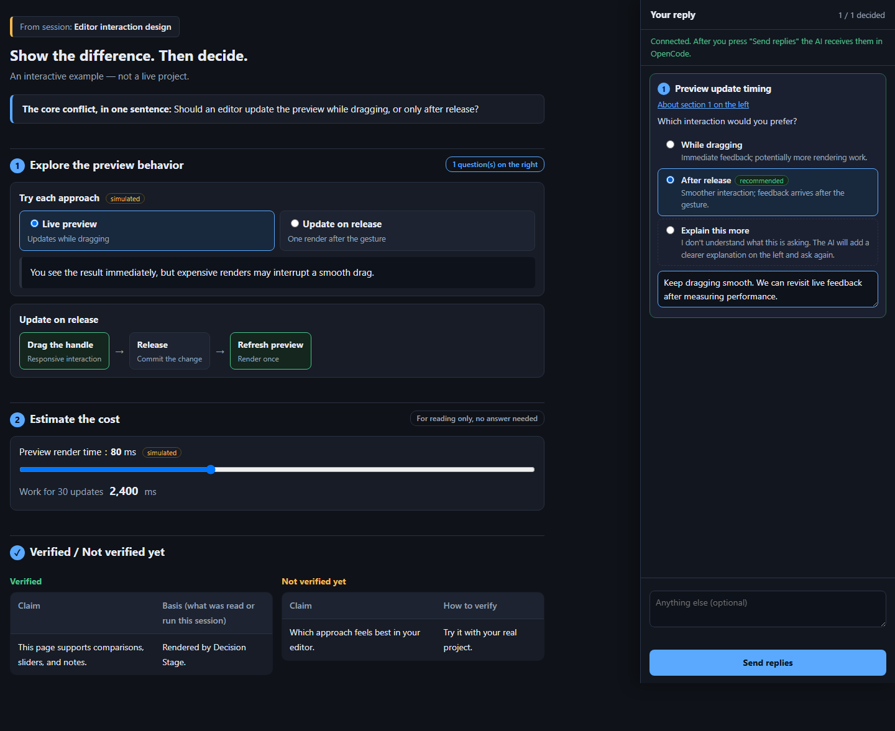

# Cropse Skill Pack

A growing collection of practical skills for AI coding agents, by [cropse](https://github.com/cropse).

Each skill is self-contained: its instructions, scripts, assets, and tests live together under `skills/<name>/`. Install only the skills you want; the pack itself is not a single skill.

## Skills

| Skill | What it helps with |
| --- | --- |
| [Decision Stage](skills/decision-stage/README.md) | Show options through diagrams and interactive demonstrations, collect answers and notes, and preserve decisions across rounds. |
| [Grill Me](skills/grill-me/SKILL.md) | Explicit shortcut to Grilling; install both skills together. |
| [Grilling](skills/grilling/SKILL.md) | Stress-test plans, decisions, and ideas through rounds of branching questions and recommendations. |

Grill Me and Grilling are based on [Matt Pocock's skills](https://github.com/mattpocock/skills), imported from commit `5beb35b040e3de97e54fa9e386d7e42d15c295c2`. Grilling is customized to route routine fact-finding through `@explore` or a cheap-model subagent, with stronger-model escalation only when needed. Each includes the upstream MIT license. To install them, copy both `skills/grill-me` and `skills/grilling` into your harness's supported skill directory. No runtime dependencies are required.

## Decision Stage

**See the options. Explore the differences. Decide with clarity.**

Turn tangled discussions into a shared page: explanations and interactive comparisons on the left, linked questions and notes on the right.



[Usage, requirements, and security notes →](skills/decision-stage/README.md)

## Installation

Clone the pack outside your harness's installed skill directories, then copy the individual skills you need. Do not overwrite existing installations without reviewing them first.

### OpenCode — macOS / Linux

```sh
git clone https://github.com/cropse/cropse-skills.git ~/cropse-skills
mkdir -p ~/.config/opencode/skills
cp -R ~/cropse-skills/skills/decision-stage ~/.config/opencode/skills/decision-stage
```

### OpenCode — Windows PowerShell

```powershell
git clone https://github.com/cropse/cropse-skills.git "$HOME\cropse-skills"
New-Item -ItemType Directory -Force "$HOME\.config\opencode\skills" | Out-Null
Copy-Item -Recurse "$HOME\cropse-skills\skills\decision-stage" "$HOME\.config\opencode\skills\decision-stage"
```

For other harnesses, copy the skill directory into that harness's supported skill location. Compatibility and dependencies are described in each skill's README.

After installation, ask your agent to use `decision-stage`. Updating the pack checkout does not automatically update copied installations; review changes and copy the desired skill again.

## Development

Keep each new skill under `skills/<skill-name>/` with a `SKILL.md` and its supporting resources. Add it to the table above, and document its dependencies and test commands.

Decision Stage requires Node.js 22+ with no npm dependencies. Run its regression tests from the repository root:

```sh
node --test skills/decision-stage/tests/*.test.mjs
```

Tests verify runtime behavior; they do not guarantee an agent follows every instruction or that LAN firewall access works from another device.

## Repository structure

```text
README.md
skills/
└── decision-stage/
    ├── SKILL.md
    ├── README.md
    ├── template.spec.json
    ├── assets/
    ├── scripts/
    ├── tests/
    └── docs/images/
```

Runtime answers, decision memory, and session data are temporary local files—not contents of this repository.
